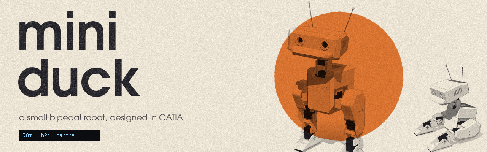
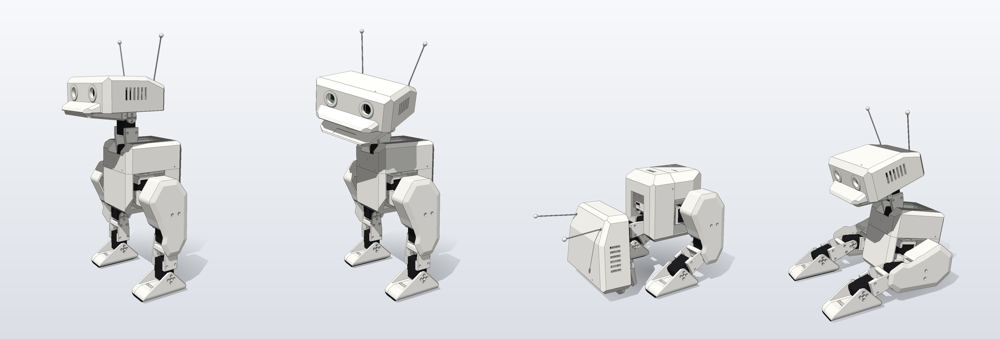
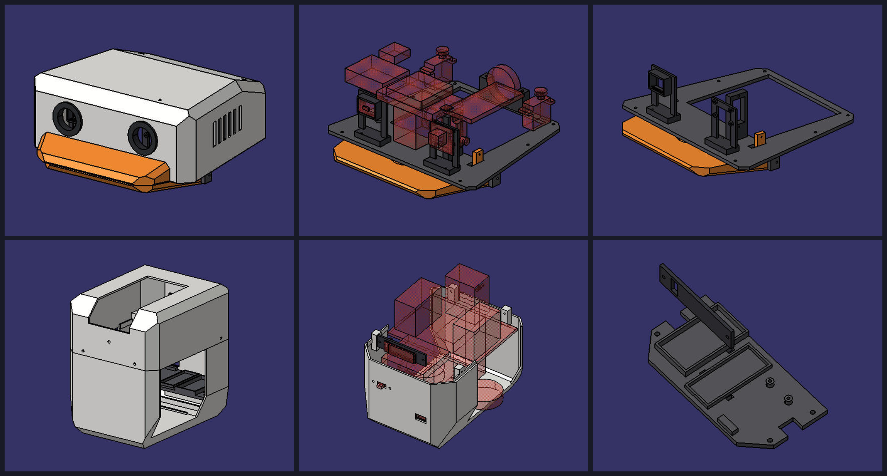
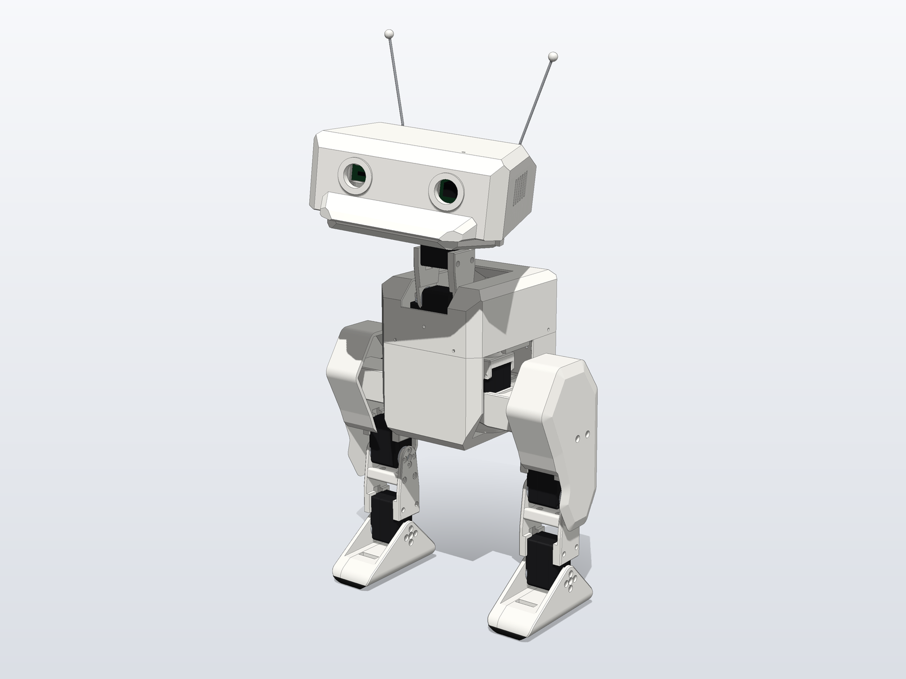
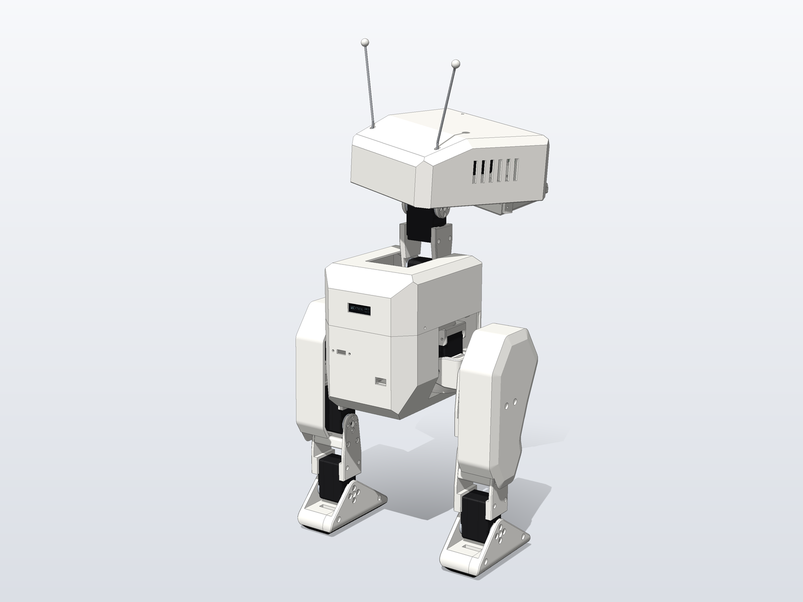
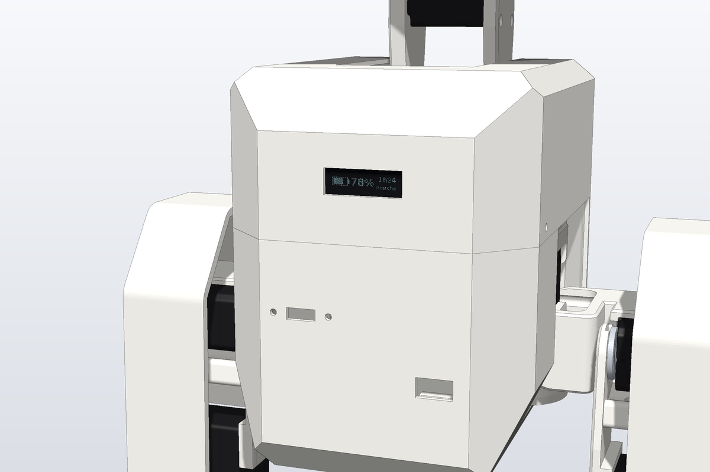
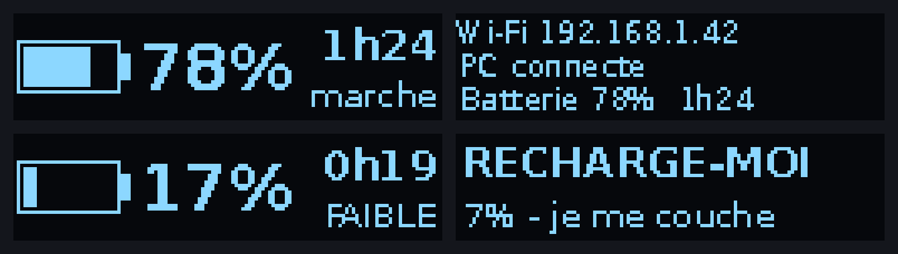

# Mini Duck

My small bipedal robot. The mechanics and the walk come from the open source [Open Duck Mini](https://github.com/apirrone/Open_Duck_Mini) project by apirrone: the walk is trained with reinforcement learning in simulation, then transferred to the real robot.

The body is my own. I redesigned the whole shell in CATIA and added a small OLED screen on the chest.

Personal project, I document it as I go.

## Design

Everything is modeled in CATIA: the head with the beak, the body, and the inner plates that hold the electronics.

| Front | Back |
|:---:|:---:|
|  |  |

## The screen

A small OLED on the chest to show the battery level, the time left and the wifi status. And it complains when the battery gets low (in French, obviously).

## Status

Work in progress.

- [x] Design the body in CATIA
- [ ] Print the parts
- [ ] Assemble the mechanics
- [ ] Wiring and electronics
- [ ] Servo calibration
- [ ] First steps with the pretrained policy
- [ ] Train my own walking policy

## Hardware

Based on Open Duck Mini v2: Raspberry Pi Zero 2W, serial bus servos, an IMU and a 3D printed body, plus the OLED screen.
The full BOM and the build guides for the base robot are in the [original repo](https://github.com/apirrone/Open_Duck_Mini).

## Photos

Renders only for now, real photos coming once it's printed.

<!-- Put photos or GIFs in the images/ folder and add them here, for example:

-->

## Build log

<!-- One line each time something changes, newest on top, for example:
- 2026-11-20: all parts printed
-->

- Full design done in CATIA, first renders

## Credits

Based on [Open Duck Mini](https://github.com/apirrone/Open_Duck_Mini) (Apache 2.0). All credit for the original robot and the training pipeline goes to apirrone and the contributors.
